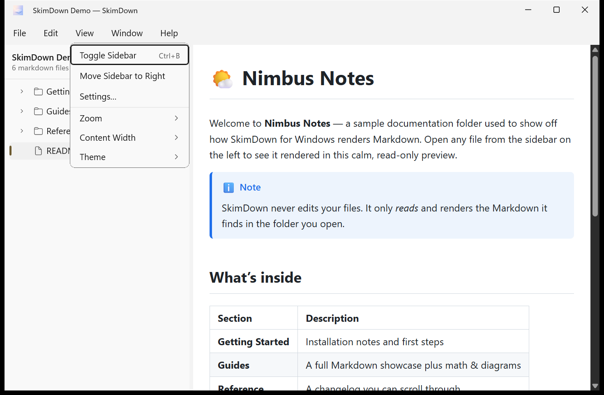
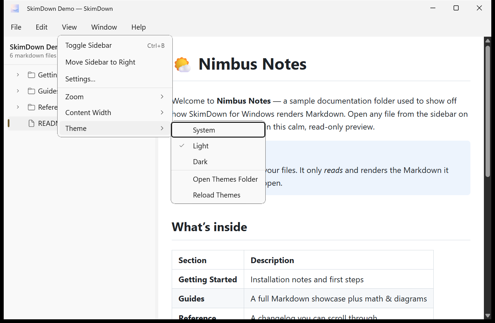
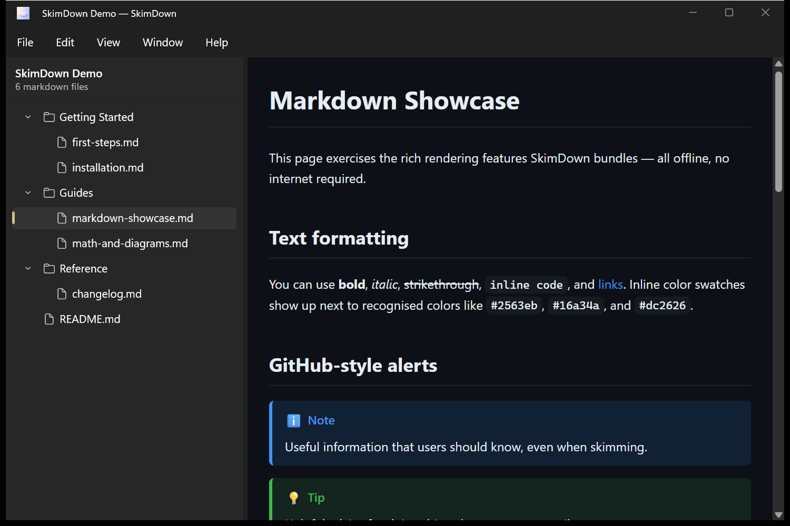
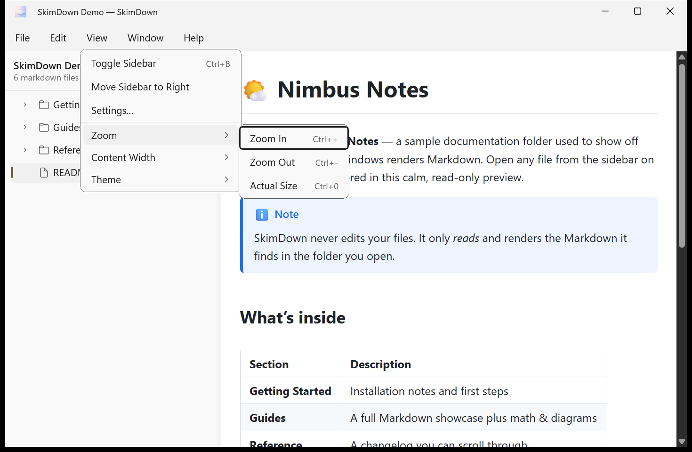
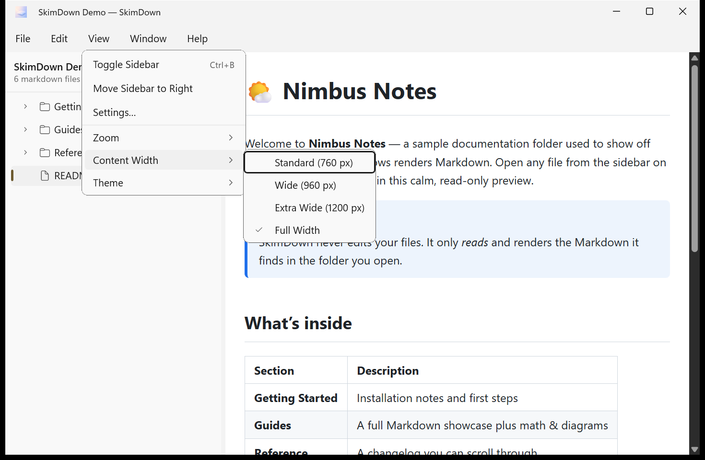
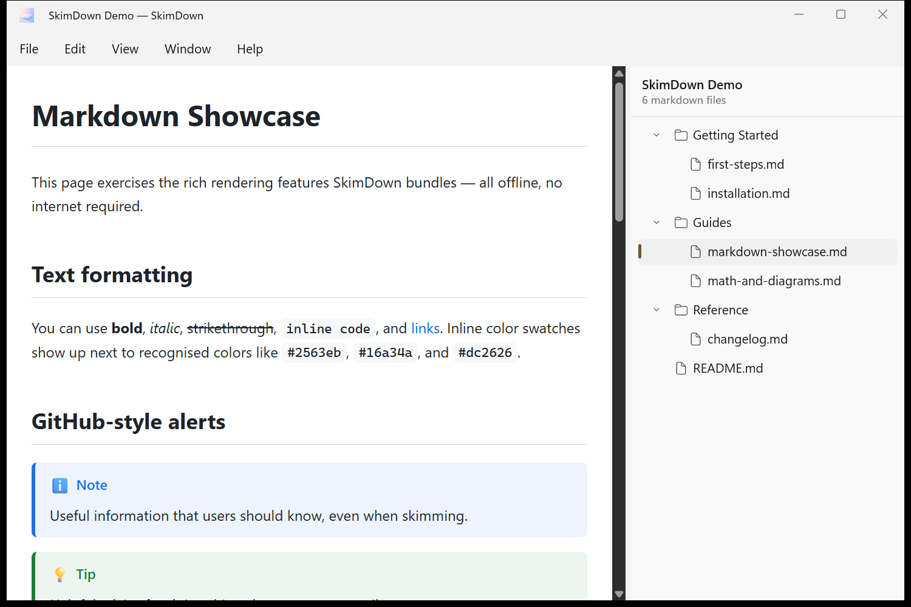

# 7. View & appearance

The **View** menu controls how content looks: the sidebar, theme, zoom, and text width.

## Git changes

Choose **View → Show Git Changes** (**Ctrl+Shift+D**) to compare Markdown with **HEAD**.
The option is **off by default**, remembered between sessions, and shared across windows.
Open the **working-tree root** (the folder containing `.git`), not a subfolder.
Git for Windows must be installed with `git.exe` on an absolute PATH entry outside the opened folder.

Added blocks have green gutter bars; modified blocks have amber bars. Consecutive changes join into
one bar. Expand **Show previous version** or a deleted-lines marker to read the old Markdown as
plain text. The sidebar shows **M** (modified), **U** (untracked), **A** (added to the index), and
folder dots. Ignored and unchanged files have no badge. Staged and unstaged changes are compared
together against HEAD, not displayed separately.

Commits, staging, branch switches, and Markdown edits refresh the comparison. Git reads only local
metadata and blobs: no `git status` / `git diff`, hooks, clean filters, external diff, or lazy fetch.
Git failures leave the normal preview available and are recorded in the app log.
In single-file mode, comparison works only when the file's parent is the working-tree root.

## Theme

Choose **View → Theme** to switch between:

- **System** — follow your Windows light/dark setting.
- **Light**
- **Dark**

The active theme is checked. The same submenu also lists any **custom color schemes** you've added,
plus **Open Themes Folder** and **Reload Themes** — see [Custom color schemes](08-custom-themes.md).

Here is the same content in **Dark** theme:

> **Note:** The **Settings** and **About** dialogs always follow your Windows system theme, so they
> may appear dark even when the preview is set to Light. This is expected.

## Zoom

Make the preview bigger or smaller with **View → Zoom**:

| Action | Shortcut |
| --- | --- |
| **Zoom In** | Ctrl + `+` |
| **Zoom Out** | Ctrl + `-` |
| **Actual Size** | Ctrl + `0` |

You can also zoom smoothly with **Ctrl + mouse wheel** or a **precision‑touchpad pinch**. The zoom
level is **remembered** between sessions and clamped to 50–300 %.

## Content width

Control how wide the text column is with **View → Content Width**:

- **Standard (760 px)** — comfortable reading measure.
- **Wide (960 px)**
- **Extra Wide (1200 px)**
- **Full Width** — use the entire preview area.

Step through the widths with **Ctrl + ]** (wider) and **Ctrl + [** (narrower).

## Sidebar

You can reposition or hide the sidebar:

- **View → Toggle Sidebar** (**Ctrl+B**) — hide or show the tree.
- **View → Move Sidebar to Right / Left** — switch which side the tree is on.

SkimDown remembers the sidebar's **position**, **visibility**, and **width** between sessions.

You can also switch the sidebar between a **folder tree** and a **date‑sorted flat list** with the
toggle in its header — see
[The folder view & navigation](03-folder-view-and-navigation.md#view-modes).
